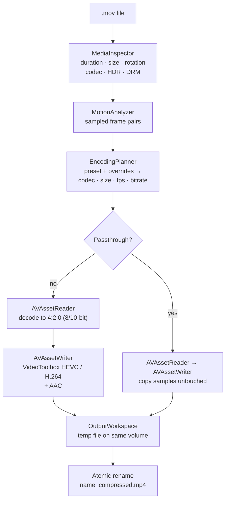

<div align="center">

# Squeeze

**Native video compression for macOS. Turn heavy `.mov` files into small, high-quality `.mp4` files, using only Apple's own frameworks.**

[](https://github.com/joaopldantas/squeeze/actions/workflows/ci.yml)


[](LICENSE)

[Features](#features) •
[Quick start](#quick-start) •
[Presets](#presets) •
[How it works](#how-it-works) •
[Design decisions](#design-decisions) •
[Benchmarks](#benchmarks) •
[Testing](#testing) •
[Roadmap](#roadmap) •
[License](#license)

</div>

---

Screen recordings and iPhone videos are huge: a five-minute screen capture can easily take up a gigabyte. Squeeze re-encodes them with the media engine in Apple Silicon. It picks a bitrate that fits the content, so a static screen recording gets far fewer bits than handheld camera footage. It keeps what matters: orientation, capture date, location and HDR.

It ships as a **Swift package** (`SqueezeCore`), a **command-line tool** (`squeeze`) and, soon, a **SwiftUI app**. All three share the same engine.

<!-- Screenshots and a demo GIF of the macOS app go here once the app ships (see Roadmap). -->

## Features

- **HEVC or H.264 in MP4:** HEVC (H.265) is the default and makes the smallest files. H.264 is there for maximum compatibility (WhatsApp, older browsers, Windows).
- **Content-aware bitrate:** the bitrate scales with resolution and frame rate. Sampled frames are compared to detect screen recordings, which get a lower bitrate. The bitrate never goes above 80% of the source's, so a re-encode doesn't come out bigger than the original.
- **Target size:** ask for "25 MB" and Squeeze works out the bitrate from the duration, after setting aside the audio and the container overhead. If the budget is too small for the resolution, it scales the video down instead of letting it turn into blocks.
- **Passthrough remux:** change only the container (`.mov` → `.mp4`) in under a second, without re-encoding.
- **Preserves what matters:**
  - **Rotation:** kept as track metadata. No pixels are rotated.
  - **Capture date and location:** copied into the MP4.
  - **HDR10 and HLG:** kept when the output is HEVC 10-bit.
  - **Dolby Vision:** kept in passthrough.
  - **Warnings:** you're told whenever the output can't keep one of these, for example HDR to SDR when you pick H.264.
- **Safe by design:**
  - **No overwrites:** existing files are never overwritten. Output names are claimed atomically: `name_compressed.mp4`, then `name_compressed_2.mp4`, and so on.
  - **No partial files:** a cancelled or failed job leaves nothing behind.
  - **Disk space check:** free space is checked before the job starts.
- **Robust with real-world files:**
  - **Typed errors:** corrupt files, DRM-protected content and full disks each fail with a specific error.
  - **Damaged endings:** a file whose last frames can't be read is still converted, with a warning.
  - **Slow motion:** 240 fps footage is brought down to 60 fps, because at 240 fps the encoder can't make each frame small enough and the file balloons.
- **Fast:**
  - **Encoding:** done by the Apple Silicon media engine through VideoToolbox. It falls back to software encoders on machines without one, such as CI virtual machines.
  - **Upload-friendly:** output is written with `faststart`, so it starts playing before it finishes downloading.

## Quick start

### Requirements

- macOS 14 Sonoma or later
- Swift 6 toolchain (Xcode 16+ or the Command Line Tools)

### Command-line tool

```bash
git clone https://github.com/joaopldantas/squeeze.git
cd squeeze
swift build -c release
cp .build/release/squeeze /usr/local/bin/   # optional
```

```bash
# Balanced preset (HEVC): the output goes next to the original
squeeze recording.mov

# Several files, H.264 720p for sharing, into a fixed folder
squeeze *.mov --preset web720 -o ~/Desktop/Shared

# Hit a file size (in MB)
squeeze trip.mov --target-size 25

# Only change the container, no re-encode
squeeze clip.mov --preset original

# Preview the plan and estimated size without converting
squeeze clip.mov --dry-run
```

Example output (the CLI messages are in Portuguese):

```text
[1/1] Golden Gate.mov
  origem:   4096×2160 · 1:00 · 240 fps · hvc1 · 73,9 MB
  plano:    Equilibrado → HEVC · 4096×2160 · 7,9 Mbps · até 60 fps · sem áudio
  estimado: 73,9 MB → 60,1 MB (−19%)
  ! Vídeo em 240 fps (câmera lenta) reduzido para 60 fps. Use FPS "manter" para preservar.
  ✓ 59,2 MB (−20%) em 63,1 s → Golden Gate_compressed.mp4
```

<details>
<summary><b>All options</b></summary>

| Option | Description |
| --- | --- |
| `-p, --preset <preset>` | `high`, `balanced` (default), `smallest`, `web720`, `web1080`, `original` |
| `--target-size <MB>` | Desired final size in decimal megabytes. Replaces the preset. |
| `--codec <codec>` | `hevc` or `h264` (the default comes from the preset) |
| `--max-size <px>` | Longest side in pixels; the aspect ratio is kept and the video is never upscaled |
| `--fps <fps>` | `keep`, `30` or `60` |
| `--bitrate <kbps>` | Manual video bitrate |
| `--audio-bitrate <kbps>` | AAC bitrate |
| `--no-audio` | Drop the audio track |
| `-o, --output <dir>` | Output folder; the default is next to the original |
| `--dry-run` | Show the plan and size estimate only |

Exit codes: `0` success, `1` at least one file failed, `130` cancelled with Ctrl-C. A first Ctrl-C cancels the current job cleanly; a second one quits immediately.

</details>

### Swift package

Add `SqueezeCore` to your `Package.swift`:

```swift
.package(url: "https://github.com/joaopldantas/squeeze.git", branch: "main")
```

```swift
import SqueezeCore

let compressor = VideoCompressor()
let request = ConversionRequest(source: url, preset: .balanced, output: .besideOriginal)

// Inspect, analyse and plan without writing anything
let preview = try await compressor.preview(request)
print(preview.plan, preview.estimate.outputBytes)

// Convert; cancelling the task stops the job and removes temporary files
let result = try await compressor.compress(request, preview: preview) { progress in
    print("\(Int(progress * 100))%")
}
print(result.outputURL, result.comparison.savedFraction, result.warnings)
```

Every failure is thrown as a typed `SqueezeError` with a user-facing description, for example `.drmProtected`, `.diskFull`, `.unreadableFile` or `.targetSizeTooSmall(minimumBytes:)`.

## Presets

| Preset | Codec | Resolution | Frame rate | Video bitrate | Audio |
| --- | --- | --- | --- | --- | --- |
| **High quality** | HEVC | Original | ≤ 60 fps | 8 Mbps at 1080p30, scaled | AAC 192 kbps |
| **Balanced** *(default)* | HEVC | Original | ≤ 60 fps | 4 Mbps at 1080p30, scaled | AAC 128 kbps |
| **Smallest** | HEVC | ≤ 1080p | ≤ 30 fps | 1.8 Mbps at 1080p30, scaled | AAC 96 kbps |
| **Web / WhatsApp** | H.264 | 720p or 1080p | ≤ 30 fps | 4 Mbps HEVC-equivalent, ×1.4 | AAC 128 kbps |
| **Target size** | HEVC | Chosen to fit the budget | ≤ 60 fps | Derived from the size, treated as a ceiling | AAC 96 kbps |
| **Keep original quality** | Passthrough | Original | Original | Original | Original (AAC if the source codec isn't allowed in MP4) |

"Scaled" means the reference bitrate is adapted to the actual output:

```text
bitrate = reference × (pixels / 1080p)^0.75 × (min(fps, 60) / 30)^0.5 × codec factor × motion factor
```

Bitrate grows more slowly than pixel count and frame rate, because larger frames and shorter frame intervals are more redundant. That is why 4K60 needs about 4× the bits of 1080p30, not 8×. The motion factor is 0.55 for static screen content and 1.15 for very busy footage. The result is then capped at 80% of the source bitrate.

Every option can be overridden: codec, maximum resolution, frame rate, video bitrate and audio.

## How it works



1. **Inspect.** `MediaInspector` reads the tracks and format descriptions. It detects HDR from the transfer function (PQ or HLG), and Dolby Vision from its codec tag or its `dvcC`/`dvvC` configuration box. DRM-protected and unreadable files are rejected here, before any work is done.
2. **Analyse.** `MotionAnalyzer` decodes a few frame pairs at 64×64 greyscale and measures two things: how many pixels *changed* and how many stayed *identical*. Screen content is pixel-exact between frames; camera footage never is, because of sensor grain. A video counts as low-motion only when both conditions hold, which keeps slow aerial pans from being starved of bits.
3. **Plan.** `EncodingPlanner` is a pure function from *(preset, source facts, motion, overrides)* to an `EncodingPlan`. It has no I/O, so every rule in it is unit-tested.
4. **Rewrite.** `AssetRewriter` pumps each track in its own lane:
   - **Back-pressure:** each lane runs `requestMediaDataWhenReady` on its own serial queue, so audio and video are interleaved by the writer itself instead of by a fixed schedule.
   - **Async bridge:** each lane is bridged to `async/await` with a checked continuation that is resumed exactly once, whether the lane drains, the writer fails or the task is cancelled.
   - **Scaling:** done in hardware by the writer.
   - **Frame rate:** frames are dropped by presentation timestamp, so variable-frame-rate iPhone footage is handled correctly.
5. **Place.** The file is written to a system-managed temporary directory on the destination volume. It is then renamed with `renamex_np(RENAME_EXCL)`, which fails instead of replacing an existing file. Two jobs finishing at the same instant can't overwrite each other, and nobody ever sees a half-written `_compressed.mp4`.

## Design decisions

### Why AVFoundation and not ffmpeg?

| | AVFoundation + VideoToolbox | ffmpeg |
| --- | --- | --- |
| Hardware encoding on Apple Silicon | Native: the media engine, with a low CPU load | Possible through `videotoolbox` encoders, with fewer controls |
| Distribution | Nothing to bundle, already on every Mac | Large bundled binary, plus a codec licensing review (GPL/LGPL, patents) |
| Sandbox / App Store | Fully compatible | Hard to impossible |
| HDR, Dolby Vision, Apple metadata | First-class (HLG, PQ, `preferredTransform`, QuickTime metadata) | Possible, but needs careful flags |
| Formats | Apple's set (H.264, HEVC, ProRes, AAC…) | Practically everything |

Squeeze's inputs are Apple's own formats: iPhone videos and macOS screen recordings. For those, the platform encoder is the fastest and best-integrated option. `AVAssetReader`/`AVAssetWriter` were chosen over `AVAssetExportSession` because export presets don't expose bitrate, resolution or frame-rate control, and that control is the whole point of the app.

### HEVC vs H.264

HEVC reaches the same perceived quality at roughly **30–40% fewer bits**, so it's the default (the bitrate model uses a 1.4× factor for H.264). H.264 stays as an option because it plays *everywhere*: messaging apps, older browsers, Windows without extra codecs. The Web/WhatsApp preset uses it for that reason. H.264 can't carry HDR, so HDR sources are tone-mapped to SDR and the user is warned.

### Re-encode vs passthrough

Re-encoding is what makes files smaller, but every re-encode loses some quality. When you only need the format (an editor or uploader that rejects `.mov`), **passthrough** copies the compressed samples into an MP4 container as-is. It is lossless, keeps Dolby Vision and takes a fraction of a second. The output is about the same size as the input (+0.4% container overhead in the benchmark below), so Squeeze doesn't raise the "file got bigger" warning for it. Codecs that MP4 doesn't allow, such as ProRes, can't be remuxed, and Squeeze says so instead of producing a broken file.

### Swift Concurrency, carefully

The package builds in **Swift 6 language mode** with strict concurrency checking. AVFoundation's reader and writer aren't `Sendable`, so the rewriter keeps each one confined to its own dispatch queue, and every shared value lives behind an `OSAllocatedUnfairLock`. The only `@unchecked Sendable` types are the ones whose thread confinement is documented next to the code.

## Benchmarks

Measured with the release CLI on an **Apple M4 Mac (16 GB), macOS 27**. The sources are the macOS wallpaper videos, which are already very efficiently encoded HEVC (4K, 240 fps). That is close to a worst case for compression: camera footage and H.264 screen recordings typically shrink much more.

| Source | Preset | Before | After | Change | Time |
| --- | --- | ---: | ---: | ---: | ---: |
| Golden Gate · 4096×2160 · 60 s | Balanced | 73.9 MB | 59.2 MB | −20% | 63 s |
| Sonoma · 3840×2160 · 90 s | Smallest | 71.9 MB | 14.0 MB | −81% | 84 s |
| Sonoma · 3840×2160 · 90 s | Web 720p (H.264) | 71.9 MB | 7.6 MB | −89% | 83 s |
| Sonoma · 3840×2160 · 90 s | Target 10 MB | 71.9 MB | 6.7 MB | −91% | 92 s |
| Sonoma · 3840×2160 · 90 s | Keep original (remux) | 71.9 MB | 72.2 MB | +0.4% | 0.6 s |

The time is dominated by *decoding* 240 fps 4K, not by encoding. On a centre crop, the Balanced output was visually indistinguishable from the source.

<!-- Add rows for an iPhone video and a macOS screen recording when available. -->

## Testing

```bash
swift test                                    # everything
swift test --filter SqueezeCoreTests          # fast, pure unit tests
swift test --filter SqueezeIntegrationTests   # real encodes
```

- **110 tests** written with **Swift Testing**, using parameterised cases wherever the rule is a table.
- **Unit tests** cover the bitrate model, target-size maths, aspect-ratio scaling, collision-free naming, preset mapping, size estimation, motion classification, frame-rate limiting, error classification and CLI parsing.
- **Integration tests** never use checked-in media. Every fixture is generated inside the test with `AVAssetWriter`, deterministically:
  - **Shapes:** landscape, portrait (stored rotated, like an iPhone), no audio, 1 second long, 60 fps.
  - **Formats:** HLG HDR (10-bit), ProRes, a static "screen recording" and a camera-like pan.
  - **Broken files:** random bytes, and files with their tail chopped off.
- **What the integration tests check on real output:**
  - **Container and codec:** the output is an MP4 with the expected codec.
  - **Orientation:** the rotation is preserved.
  - **Size:** the output is smaller than the input (except for passthrough).
  - **Metadata and HDR:** metadata survives, and HDR is kept with HEVC and tone-mapped with H.264.
  - **Cancellation:** a job cancelled halfway leaves the folder exactly as it was.
- **CI:** GitHub Actions runs SwiftLint (`--strict`), the build and both test suites on `macos-latest` for every push and pull request.

## Project structure

```text
Sources/
├── SqueezeCore/                  # The engine (library, no UI)
│   ├── Domain/                   # Pure logic: presets, planner, bitrate, scaling, naming
│   ├── Analysis/                 # MediaInspector, MotionAnalyzer
│   ├── Pipeline/                 # AssetRewriter, writer settings, metadata, output workspace
│   ├── Errors/                   # SqueezeError and error classification
│   └── VideoCompressor.swift     # Public entry point: preview() and compress()
└── SqueezeCLI/                   # `squeeze` command (swift-argument-parser)
Tests/
├── SqueezeCoreTests/             # Unit tests
├── SqueezeCLITests/              # Argument parsing and output formatting
└── SqueezeIntegrationTests/      # End-to-end encodes with generated fixtures
```

## Roadmap

- [x] `SqueezeCore` engine with unit and integration tests
- [x] `squeeze` command-line tool
- [ ] SwiftUI app: drag and drop, "Open With", before/after estimate per file
- [ ] Batch queue with limited concurrency and per-item cancellation
- [ ] "Show in Finder" and a notification when a batch finishes
- [ ] Finder Quick Action: *Compress with Squeeze*

## Contributing

Issues and pull requests are welcome. Before opening a PR:

```bash
swiftlint lint --strict
swift test
```

Commits follow [Conventional Commits](https://www.conventionalcommits.org/) (`feat(core): …`, `fix(cli): …`).

## License

Squeeze is released under the [MIT License](LICENSE).
